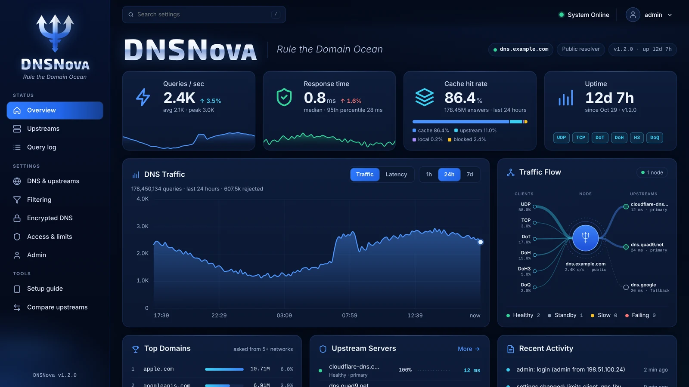
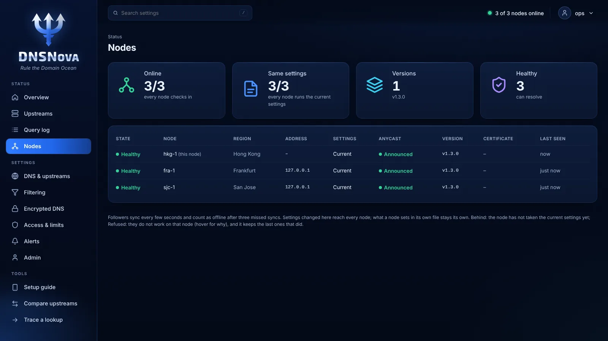
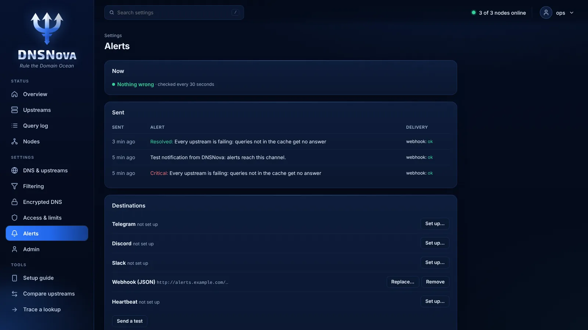

# DNSNova

> A secure DNS server, from one box at home to a public resolver on several continents.

[](https://github.com/harryheros/dnsnova/releases)
[](./LICENSE)
[](#)
[](https://github.com/harryheros/dnsnova/actions/workflows/ci.yml)
[](https://github.com/harryheros/dnsnova/actions/workflows/fuzz.yml)

DNSNova answers DNS queries from its cache, by resolving them itself from the root servers with DNSSEC, or through upstream resolvers you choose, over plain DNS, DNS over TLS, DNS over QUIC and DNS over HTTPS. It is one program with no dependencies, set up and run from the browser, and it keeps no logs of the queries it answers.

The same server fits two jobs. **At home or in an office**, it is a private resolver with optional ad and tracker blocking that you set up in a few minutes. **On the internet**, it is a public resolver built to be exposed: rate limits and DNS Cookies against abuse, a self-check of its own security, several nodes run from one configuration behind anycast, and alerts when something goes wrong.



## New in 1.3

1.3 turns DNSNova from a resolver for one network into one you can run as a public service:

- **Several nodes, one configuration**: followers take their settings from a primary and report back; each node's anycast route is announced only while it can answer, and withdrawn first when it stops ([docs/cluster.md](./docs/cluster.md)).
- **Alerts** to Telegram, Discord, Slack or a signed webhook when upstreams fail, errors or response times stay high, DNSSEC failures pile up or the certificate nears expiry, and again when it is fixed, plus a heartbeat for outside monitoring ([docs/alerts.md](./docs/alerts.md)).
- **Diagnostics**: trace a lookup from the root, server by server, with the DNSSEC verdict on each zone, and a DNSSEC page of the domains that fail validation and why.
- **Harder to abuse and to fool**: DNS Cookies (RFC 7873) towards clients and towards name servers, PROXY protocol behind load balancers, and a security self-check at startup and after every change.
- **Faster to recover**: the cache is saved and loaded back across restarts, and UDP is read and written in batches.

Upgrading from 1.2: on a public server, the web interface no longer opens over plain HTTP from other machines. See the [changelog](./CHANGELOG.md) before upgrading.

## Install

On Linux with systemd (amd64 or arm64), as root:

```sh
curl -fsSL https://raw.githubusercontent.com/harryheros/dnsnova/main/install.sh | sh
```

As a normal user it asks for your sudo password; without sudo (common on Debian), log in as root first with `su -`.

For a home or office network, add `--lan` (`| sh -s -- --lan`): DNS then answers your private networks only, and the web interface opens directly from them:

```
DNSNova is installed and running.
Open one of these addresses from a device on your network and follow the setup wizard:
  http://192.168.1.10:7000
  http://127.0.0.1:7000
```

Without it, the server is set up for the internet. Its web interface is not encrypted until a domain and certificate are set up, so until then it opens only on the server itself; from your computer, go through an SSH tunnel:

```
DNSNova is installed and running.
The web interface is not encrypted yet, so it opens only on this server.
On your computer, open a tunnel:
  ssh -L 7000:127.0.0.1:7000 root@203.0.113.10
then open http://127.0.0.1:7000/ and follow the setup wizard.
```

Follow the wizard: administrator password, who the server is for (your home or office network, or anyone on the internet) and where plain DNS answers, whether DNSNova resolves names itself or asks upstreams, a domain for encrypted DNS (optional), and filtering. DNS starts when you finish, and the last page says what to set on your router or devices. Everything the wizard asks can also be given on the command line: `install.sh --help`.

To upgrade, run the install command again: the configuration is kept, and if the new version does not start, the previous one is put back. To uninstall, add `-u` (`| sh -s -- -u`); the configuration stays in `/etc/dnsnova` unless you also add `--purge`.

Forgot the administrator password? Run `dnsnova -reset-admin` on the server; the web interface then offers to create the administrator again, and every setting is kept.

## What it does

### Answering

- **Plain and encrypted DNS**: UDP and TCP on port 53, DNS over TLS, DNS over QUIC and DNS over HTTPS (HTTP/2 and HTTP/3), with an automatic Let's Encrypt certificate.
- **Its own resolver, or forwarding**: resolve names from the root servers, with DNSSEC validation and minimal names, so no third party sees the queries; or forward to upstreams such as Cloudflare or Quad9 over DNS over HTTPS, TLS or QUIC. With both, the upstreams step in when a domain's own servers cannot be reached.
- **Optional filtering, without forcing it on anyone**: one server, two doors. The usual addresses answer everything; a second address, name or DoH path blocks ads, trackers and malware, with the [ShieldNova](https://github.com/harryheros/shieldnova) list by default (free to use in DNSNova, commercially too) or any AdGuard-style, hosts or domain list. A broken list update never replaces a good list, *Check a domain* shows which list blocks a name, and a wrongly blocked domain is allowed again with one click. Trackers disguised as a site's own subdomain (CNAME cloaking) are blocked too.
- **Local names** such as `nas.home`, and a list of blocked clients.
- **Answers for another network** (EDNS Client Subnet): give it an address, and name servers answer as they would for that network, wherever the server is. Never your clients' addresses. For measurement tools, a secret DoH path can pass each query's own network on instead.

### On the internet

- **Public or private**: open to everyone with rate limits that stop abuse, or only to the networks you list.
- **Hard to poison**: answers are only accepted from the server asked, for the question asked, on a random port with a random ID; DNS Cookies show which ones really came from it, and a flood of forged answers, or an answer with the wrong cookie, sends the question again over TCP, which cannot be forged from outside.
- **Hard to abuse**: per-client and per-network limits, response rate limiting against reflection, and DNS Cookies that let real clients through it. ANY queries can be refused.
- **Secure by default**: the web interface opens only on the server itself until it has HTTPS, with two-step verification available; at startup and after every change, a self-check reports what would weaken the server, such as secrets other users can read or metrics open to the internet.
- **Behind load balancers**: the PROXY protocol (v1 and v2) gives each client's real address, from the balancers you list only.

### Many servers

- **One configuration for a fleet**: a primary hands its settings to followers over an encrypted, authenticated channel; each node keeps what it sets in its own file, and a node that cannot use a new configuration keeps the last good one and says why.
- **Anycast with health checks**: your own commands announce the route while the node can answer and withdraw it when it cannot. At shutdown the route is withdrawn first, and the node keeps answering while traffic drains away.
- **One view**: a Nodes page with each node's state, version, settings and certificate, and the fleet's state in the top bar.



### Running it

- **Web interface**: queries per second, response times, cache hit rate and traffic over time, how queries flow from each protocol to the upstreams, upstream health, the most queried domains, and every setting with a preview before it is applied and a history to go back to.
- **Alerts and monitoring**: notifications to Telegram, Discord, Slack or a webhook, a heartbeat for an outside monitor, Prometheus metrics and a health check.
- **Diagnostics**: trace any lookup from the root; the DNSSEC page lists failing domains and can exempt one whose owner broke it (RFC 7646); a query log for troubleshooting runs in memory and stops by itself.
- **Fast**: on a single CPU core, about 200,000 answers per second from the cache, 94,000 over DNS over TLS and 23,000 for names it has to look up; a 225,000-rule blocklist costs about 14%. [How this was measured](./docs/benchmark.md).
- **Quick to recover**: the cache is saved and loaded back across restarts (on public servers by default), failures are remembered briefly so a broken domain cannot flood the upstreams, and Extended DNS Errors tell clients why an answer failed.
- **Private**: queries and client addresses are never written to disk, and there is no telemetry. See [PRIVACY.md](./PRIVACY.md).
- **Status page** (optional): a public page with the addresses, setup steps for each kind of device, and a check that shows a visitor whether their device is using the server.



## Encrypted DNS

Give the setup wizard (or Settings › Encrypted DNS) a domain that points to the server: DNSNova gets a free Let's Encrypt certificate and renews it by itself. Open TCP 853, UDP 853 and TCP + UDP 443 in the firewall (port 443, or 80 if nothing listens on 443, is also how Let's Encrypt checks the domain). Devices then use:

| Protocol | Address |
|---|---|
| DNS over TLS | `dns.example.com` |
| DNS over QUIC | `quic://dns.example.com` |
| DNS over HTTPS | `https://dns.example.com/dns-query` |
| DNS over HTTPS, with filtering on | `https://dns.example.com/filtered` |

To offer only encrypted DNS, choose *Only this server* in the setup wizard: plain DNS then answers on 127.0.0.1 alone, and nothing on port 53 is open to the internet.

## Documentation

- [`dnsnova.example.toml`](./dnsnova.example.toml): every setting, explained. The file is `/etc/dnsnova/dnsnova.toml`; changes apply when it is saved.
- [docs/cluster.md](./docs/cluster.md): several servers sharing one configuration, and anycast.
- [docs/alerts.md](./docs/alerts.md): notifications, what is checked, the webhook format.
- [docs/api.md](./docs/api.md): the admin API used by the web interface, for scripts.
- [docs/benchmark.md](./docs/benchmark.md): performance, and how to measure it yourself.
- [tools/resolver-check.sh](./tools/resolver-check.sh): checks a running server from the outside (popular domains, DNSSEC, minimal names, TCP, response times) next to a reference resolver: `bash resolver-check.sh <server-ip>`.
- [CHANGELOG.md](./CHANGELOG.md), [PRIVACY.md](./PRIVACY.md), [SECURITY.md](./SECURITY.md) (report vulnerabilities privately).

Build from source (Go 1.27 or later): `CGO_ENABLED=0 go build -o dnsnova ./cmd/dnsnova`. Tests: `go test -race ./...`; every parser is also fuzzed nightly.

## License

[GNU Affero General Public License v3.0](./LICENSE): free for any use, including commercial. If you modify DNSNova and offer it to others as a network service, you must make your modified source available to them. For other terms, a commercial license is available: see [COMMERCIAL.md](./COMMERCIAL.md). Contributions are welcome under the [contributor license agreement](./CONTRIBUTING.md). Third-party components: [THIRD_PARTY_NOTICES.md](./THIRD_PARTY_NOTICES.md).

Part of the [Nova projects](https://github.com/harryheros).
