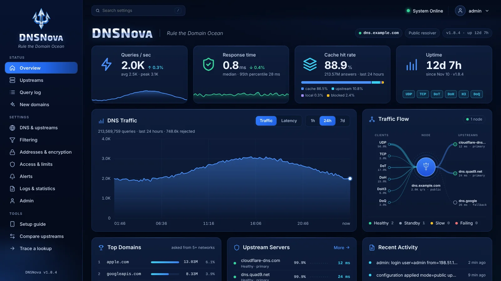

<div align="center">

# DNSNova

**A secure DNS server, from one box at home to a public resolver on several continents.**

[](https://github.com/harryheros/dnsnova/releases)
[](#license)
[](#install)
[](https://github.com/harryheros/dnsnova/actions/workflows/ci.yml)
[](https://github.com/harryheros/dnsnova/actions/workflows/fuzz.yml)

[Install](#install) · [What it does](#what-it-does) · [Encrypted DNS](#encrypted-dns) · [Documentation](#documentation) · [Changelog](./CHANGELOG.md) · [License](#license)

</div>

DNSNova resolves names itself, from the root servers with DNSSEC, or forwards them to upstreams you choose. It answers over plain DNS, DNS over TLS, DNS over QUIC and DNS over HTTPS. One program, no dependencies, managed from the browser, no query logs unless you choose to keep them.

**At home or in an office**: a private resolver with optional ad and tracker blocking, set up in minutes. **On the internet**: a public resolver built to be exposed, with rate limits, DNS Cookies, a security self-check, multi-node clusters behind anycast, and alerts.



## Install

On Linux with systemd (amd64, arm64, or 32-bit ARM such as Raspberry Pi OS 32-bit), as root:

```sh
curl -fsSL https://raw.githubusercontent.com/harryheros/dnsnova/main/install.sh | sh
```

Without root it uses sudo (or run `su -` first where there is none). The installer prints where to open the setup wizard:

- **Home or office**: add `--lan` (`| sh -s -- --lan`). DNS answers your private networks only, and the wizard opens directly from them at `http://<server>:7000`.
- **Internet**: until it has a certificate, the web interface opens only on the server itself. Reach it with `ssh -L 7000:127.0.0.1:7000 root@<server>`, then `http://127.0.0.1:7000`.

The wizard sets the administrator, who the server is for, recursion or upstreams, a domain for encrypted DNS and filtering, then shows what to set on your router or devices. Every choice is also a command-line option: `install.sh --help`.

- **Firewall**: open what you use: port 53 over UDP and TCP; 853 (TCP and UDP) and 443 (TCP and UDP) for encrypted DNS. With ufw or firewalld on, the installer prints the commands.
- **Containers**: in LXC or OpenVZ containers that cannot sandbox services, the installer runs DNSNova without the sandbox (a drop-in in `/etc/systemd/system/dnsnova.service.d`). Without systemd (Docker, Alpine), run the binary from the release yourself: `dnsnova -c /etc/dnsnova/dnsnova.toml`.
- **Upgrade**: run the install command again. The configuration is kept; if the new version fails to start, the previous one is restored. From 1.2 or earlier, read the [changelog](./CHANGELOG.md) first.
- **Verify a release** (optional): the installer checks each download against the release's SHA256SUMS. Each file is also signed with its build provenance: `gh attestation verify dnsnova-linux-amd64.tar.gz -R harryheros/dnsnova` shows it was built by this repository's release workflow from the tagged commit.
- **Uninstall**: add `-u` (`| sh -s -- -u`). The configuration stays in `/etc/dnsnova` unless you add `--purge`.
- **Lost password**: run `dnsnova -reset-admin` on the server, then create the administrator again in the web interface. Settings are kept.

## What it does

### Answering

- **Plain and encrypted DNS**: UDP and TCP on port 53, DNS over TLS, DNS over QUIC and DNS over HTTPS (HTTP/2 and HTTP/3), with an automatic Let's Encrypt certificate.
- **Recursion or forwarding**: resolve from the root servers with DNSSEC validation and minimal names, so no third party sees the queries; or forward to upstreams such as Cloudflare or Quad9 over DoH (HTTP/2 or HTTP/3), DoT or DoQ. With both, upstreams are used only when a domain's own servers cannot be reached.
- **Opt-in filtering**: the usual addresses answer everything; a second address, name or DoH path blocks ads, trackers, malware and CNAME-cloaked trackers. The default list is [ShieldNova](https://github.com/harryheros/shieldnova) (free to use in DNSNova, commercially too); AdGuard-style, hosts, RPZ and domain lists also work. A broken list update never replaces a working list, *Check a domain* shows which list blocks a name, and one click allows it again.
- **Client groups**: devices sorted by network, each group with its own filtering and its own blocked or allowed domains (the finance office filtered, the lab never, social networks blocked for guests).
- **Local names** such as `nas.home`; **domains with their own servers**, such as an office's Active Directory or a router's device names, asked only there; blocked clients; and EDNS Client Subnet for a network you choose (never your clients' addresses).
- **DNS rebinding protection**: a name from outside that answers with an address of your network gets none, so a web page cannot reach your router, NAS or printer through it; your own names are let through, and one click in the query log allows a public name you gave a device at home.

### On the internet

- **Public or private**: open to everyone within rate limits, or only to the networks you list; behind load balancers, PROXY protocol v1 and v2 from the ones you list.
- **Hard to poison**: random ports and IDs, answers checked against the server and question asked, and DNS Cookies. Forged answers, including those injected on the path, are dropped and the genuine one is used; an attack in progress moves the question to TCP. A network that answers port 53 itself is detected, never cached ([details](./docs/restricted-networks.md)).
- **Hard to abuse**: per-client and per-network limits, response rate limiting against reflection, and DNS Cookies that exempt real clients.
- **Secure by default**: on a public server the web interface stays on the server itself until it has HTTPS; two-step verification; a self-check at startup and after every change reports weaknesses.

### Many servers

- **One configuration for a fleet**: a primary sends its settings to followers over an encrypted, authenticated channel; a node that cannot apply them keeps the last working ones and reports why. A Nodes page shows the fleet ([docs/cluster.md](./docs/cluster.md)).
- **Anycast with health checks**: the route is announced while the node can answer and withdrawn when it cannot, and first at shutdown, while traffic drains. Clients can ask which node answered (`dig +nsid`).

### Running it

- **Web interface**: queries per second, response times, cache hit rate and traffic history, query flow by protocol, upstream health, top domains, and every setting, previewed before it is applied and kept in a history.
- **New domains**: tells, on the page and through alerts, when a domain is looked up here for the first time, often the first sign of phishing; one click blocks it. It keeps only hashes, no list of domains.
- **Alerts and monitoring**: Telegram, Discord, Slack or webhook notifications, a heartbeat for outside monitors, Prometheus metrics and a health check ([docs/alerts.md](./docs/alerts.md)).
- **Diagnostics**: trace any lookup from the root, server by server; a DNSSEC page of failing domains, each exemptible (RFC 7646); an in-memory query log that stops by itself.
- **Fast**: on one CPU core, about 200,000 answers per second from the cache, 94,000 over DNS over TLS, and 23,000 for new names forwarded to an upstream; a 225,000-rule blocklist costs about 14% ([method](./docs/benchmark.md)).
- **Quick to recover**: the cache survives restarts (by default on public servers), with what recursion learnt about which name servers answer fastest, and recent failures are remembered so a broken domain cannot flood upstreams. When the cache is full, answers clients keep asking for stay and ones asked once go first. A machine started with a wrong clock (DNSSEC then fails) is noticed and reported, with by how much.
- **Private by default**: no telemetry, and queries and client addresses are not written to disk ([PRIVACY.md](./PRIVACY.md)). Queries to encrypted upstreams are padded, so their length does not tell the name; queries that do not ask for recursion are refused, so nobody can read what others looked up from the cache. Where an office must account for its DNS, it can keep every query for a number of days (searchable and downloadable in the web interface, and stated on the status page) or send them as dnstap to a SIEM or log collector.
- **Status page** (optional): addresses, setup steps per device, and a check that shows visitors whether they use the server.

## Encrypted DNS

Give the setup wizard (or Settings › Addresses & encryption) a domain that points to the server, and DNSNova obtains and renews a Let's Encrypt certificate (validated on port 443, or on 80 if nothing listens on 443). With the ports under [Install](#install) open, devices then use:

| Protocol | Address |
|---|---|
| DNS over TLS | `dns.example.com` |
| DNS over QUIC | `quic://dns.example.com` |
| DNS over HTTPS | `https://dns.example.com/dns-query` |
| DNS over HTTPS, with filtering on | `https://dns.example.com/filtered` |

For encrypted DNS only, choose *Only this server* in the wizard: plain DNS then answers on 127.0.0.1 alone.

## Documentation

- [`dnsnova.example.toml`](./dnsnova.example.toml): every setting, explained. The live file is `/etc/dnsnova/dnsnova.toml`; changes apply on save.
- [docs/cluster.md](./docs/cluster.md): several servers sharing one configuration, and anycast.
- [docs/alerts.md](./docs/alerts.md): notifications, what is checked, the webhook format.
- [docs/restricted-networks.md](./docs/restricted-networks.md): resolving where DNS answers are forged or intercepted on the path.
- [docs/server-itself.md](./docs/server-itself.md): programs on the server itself (apt, certificate renewal, mail) using DNSNova.
- [docs/api.md](./docs/api.md): the admin API used by the web interface, for scripts.
- [docs/benchmark.md](./docs/benchmark.md): performance, and how to measure it yourself.
- [tools/resolver-check.sh](./tools/resolver-check.sh): compares a running server with a reference resolver (popular domains, DNSSEC, minimal names, TCP, response times): `bash resolver-check.sh <server-ip>`.
- [CHANGELOG.md](./CHANGELOG.md), [PRIVACY.md](./PRIVACY.md), [SECURITY.md](./SECURITY.md) (report vulnerabilities privately).

Build from source (Go 1.27.4 or later): `CGO_ENABLED=0 go build -o dnsnova ./cmd/dnsnova`. Tests: `go test -race ./...`; every parser is also fuzzed weekly.

## License

[GNU Affero General Public License v3.0](./LICENSE): free for any use, including commercial. If you modify DNSNova and offer it as a network service, you must make your modified source available to its users. For other terms, see the commercial license in [COMMERCIAL.md](./COMMERCIAL.md), or ask at [novaod.com/licensing](https://novaod.com/licensing). Contributions are welcome under the [contributor license agreement](./CONTRIBUTING.md). Third-party components: [THIRD_PARTY_NOTICES.md](./THIRD_PARTY_NOTICES.md).

Part of the [Nova infrastructure toolkit](https://github.com/harryheros).
